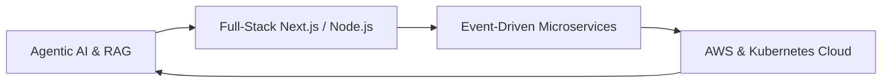

<div align="center">

# 👋 Hi, I'm Mahesh Chitakoti

### Full-Stack AI Engineer | Distributed Systems & Cloud Architect


<p align="center">
  <a href="https://linkedin.com/in/maheshchitakoti"></a>
  <a href="https://twitter.com/maheshkc42"></a>
  <a href="https://www.leetcode.com/maheshchitakoti"></a>
  <a href="mailto:maheshchitkoti@gmail.com"></a>
</p>


</div>

## 🚀 About Me

```typescript
const mahesh: FullStackAIEngineer = {
  location: "Bengaluru, India 🇮🇳",
  currentRole: "Full-Stack Developer @ WorkBridge",
  company: "https://www.workbridgeco.com/",

  expertise: {
    frontend: ["React", "Next.js", "TypeScript", "Tailwind CSS", "shadcn/ui"],
    backend: ["Node.js", "NestJS", "Express", "Spring Boot", "FastAPI", "GraphQL"],
    agenticAI: ["LangChain", "LangGraph", "LlamaIndex", "MCP", "OpenAI API", "RAG Systems"],
    databases: ["PostgreSQL (pgvector)", "Pinecone", "MongoDB", "Redis", "Elasticsearch"],
    cloudDevOps: ["AWS (Lambda, ECS, EC2, S3, RDS)", "Docker", "Kubernetes", "Terraform"]
  },

  architectureFocus: [
    "Production-grade Agentic AI workflows & hybrid RAG pipelines",
    "Event-driven microservices with Apache Kafka & Kubernetes",
    "Low-latency full-stack SaaS applications at 100K+ DAU scale"
  ],

  lifePhilosophy: "Code is poetry, bugs are just plot twists 🎭"
};
```

## 💼 Engineering Impact & Highlights

- 🔹 **Full-Stack Product Delivery:** Architected, built, and deployed 10+ production web applications using React, Next.js, Node.js, and AWS cloud infrastructure
- 🔹 **Agentic AI & RAG Systems:** Engineered LLM-powered workflows using LangChain, LangGraph, OpenAI API, Model Context Protocol (MCP), and vector databases (Pinecone / pgvector)
- 🔹 **High-Scale System Design:** Designed event-driven microservices handling **100K+ daily active users** with high availability and fault-tolerant caching
- 🔹 **Cloud & CI/CD Automation:** Automated AWS deployments using Docker, Kubernetes, and GitHub Actions pipelines, cutting release cycles by **70%**
- 🔹 **Open Source & DX:** Active contributor to modern TypeScript, React, and AI developer tooling

## 🎯 Featured Production Systems

<div align="center">

<table width="100%">
<tr>
<td width="50%" valign="top">
<h3 align="center">🌉 WorkBridge Platform</h3>
<div align="center">
<a href="https://www.workbridgeco.com/"></a>
<p><strong>React • Node.js • PostgreSQL • AWS</strong><br/>
Enterprise workforce management platform powering real-time team collaboration, role-based access, and automated operational workflows.</p>
</div>
</td>
<td width="50%" valign="top">
<h3 align="center">🤖 Agentic RAG Copilot</h3>
<div align="center">

<p><strong>Next.js • LangGraph • OpenAI • Pinecone • MCP</strong><br/>
Stateful multi-step AI assistant with hybrid semantic search, tool calling, memory management, and grounded enterprise document retrieval.</p>
</div>
</td>
</tr>
<tr>
<td width="50%" valign="top">
<h3 align="center">📊 Real-Time Telemetry Engine</h3>
<div align="center">

<p><strong>React • TypeScript • D3.js • Express • Redis</strong><br/>
High-throughput analytics dashboard streaming live operational metrics via WebSockets with interactive visualizations and sub-second caching.</p>
</div>
</td>
<td width="50%" valign="top">
<h3 align="center">🏗️ Event-Driven Microservices Core</h3>
<div align="center">

<p><strong>Node.js • Spring Boot • Kafka • Docker • K8s</strong><br/>
Distributed backend architecture featuring asynchronous event queues, API Gateway routing, automated horizontal scaling, and Prometheus observability.</p>
</div>
</td>
</tr>
</table>

</div>

## 🛠️ Technology Arsenal

<details open>
<summary><b>⚡ Core Stack & Production Tooling</b></summary>
<br/>

**AI, Agents & Retrieval**
```text
OpenAI API • Anthropic Claude • LangChain • LangGraph • LlamaIndex
Model Context Protocol (MCP) • Hybrid RAG • Tool Calling • LangSmith
Pinecone • PostgreSQL (pgvector) • Hugging Face • Semantic Embeddings
```

**Frontend Engineering**
```text
React.js • Next.js (App Router) • TypeScript • JavaScript (ES6+) • HTML5 • CSS3
Tailwind CSS • shadcn/ui • Material-UI • Framer Motion • D3.js • Chart.js
Redux Toolkit • TanStack React Query • Zustand • WebSockets
```

**Backend & Distributed Systems**
```text
Node.js • NestJS • Express.js • Java • Spring Boot • Spring Security
Python • FastAPI • Flask • GraphQL • RESTful APIs • Server-Sent Events
Apache Kafka • RabbitMQ • AWS SQS • Event-Driven Microservices
```

**Databases, Caching & ORM**
```text
PostgreSQL • MongoDB • MySQL • MS SQL Server • Redis • Elasticsearch
Prisma ORM • TypeORM • Mongoose • Query Optimization & Indexing
```

**Cloud, DevOps & Observability**
```text
AWS (EC2, ECS, Lambda, S3, RDS, CloudFront, API Gateway, SQS)
Docker • Kubernetes • Terraform (IaC) • GitHub Actions • Jenkins • GitLab CI
Grafana • Prometheus • ELK Stack • Linux • Nginx • PM2
```

**Testing & Quality Assurance**
```text
Playwright • Cypress • Jest • React Testing Library • Postman • OpenAPI / Swagger
```

</details>

## 📊 GitHub Analytics & Trophies

<div align="center">

<a href="https://github.com/maheshchichkoti"></a>

<br/><br/>


<br/><br/>


<br/><br/>


</div>

## 🎓 Cloud & Architecture Focus

<div align="center">


</div>

<br/>



- 🔭 **Currently building:** Multi-agent AI workflows, hybrid RAG pipelines, and cloud-native SaaS applications
- 🌱 **Deepening expertise in:** Stateful agent orchestration (`LangGraph` / `MCP`), distributed system design, and LLM observability
- 💬 **Ask me about:** React/Next.js, Node.js, Spring Boot, AWS architecture, or production LLM integration
- ⚡ **Fun fact:** I debug production issues faster than I can find my keys in the morning

## 📫 Let's Connect & Collaborate

<div align="center">

<p align="center">
  <a href="mailto:maheshchitkoti@gmail.com"></a>
  <a href="https://linkedin.com/in/maheshchitakoti"></a>
  <a href="https://twitter.com/maheshkc42"></a>
  <a href="https://www.buymeacoffee.com/mahesh042"></a>
</p>

✨ *"Code is like humor. When you have to explain it, it's bad."* — Cory House

<br/><br/>


<br/>


</div>
