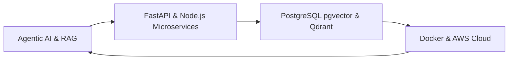

<div align="center">

# 👋 Hi, I'm Mahesh Chitakoti

### Full-Stack AI Engineer | Distributed Systems & Cloud Architect


<p align="center">
  <a href="https://linkedin.com/in/maheshchitakoti"></a>
  <a href="https://twitter.com/maheshkc42"></a>
  <a href="https://www.leetcode.com/maheshchitakoti"></a>
  <a href="mailto:maheshchitkoti@gmail.com"></a>
</p>


</div>

## 🚀 About Me

```typescript
const mahesh: FullStackAIEngineer = {
  location: "Bengaluru, India 🇮🇳",
  currentFocus: "Production Agentic Workflows & High-Throughput Microservices",
  flagshipProject: "https://workbridgee.vercel.app",

  expertise: {
    frontend: ["React.js", "Next.js (App Router)", "TypeScript", "Tailwind CSS", "Redux Toolkit"],
    backend: ["Python", "FastAPI", "AsyncIO", "Node.js", "NestJS", "Express.js", "WebSockets"],
    agenticAI: ["LangGraph", "LangChain", "Hybrid RAG (Dense + BM25)", "Pydantic", "Gemini API", "OpenAI API"],
    retrievalDatabases: ["Qdrant", "PostgreSQL (pgvector HNSW)", "Redis (Semantic Cache)", "MongoDB"],
    cloudDevOps: ["AWS (EC2, S3)", "Docker", "GitHub Actions CI/CD", "Linux", "k6 Load Testing"]
  },

  architectureFocus: [
    "Stateful multi-step agentic orchestration with self-healing structured outputs",
    "Hybrid semantic retrieval with dense embeddings, BM25 indexing & token rate limiters",
    "High-throughput event-driven microservices sustaining <150ms p95 latency under load"
  ],

  lifePhilosophy: "Code is poetry, bugs are just plot twists 🎭"
};
```

## 💼 Engineering Impact & Highlights

- 🔹 **Agentic AI & LLM Evaluation:** Architected multi-step LangGraph workflows with Gemini APIs & Pydantic validation, eliminating broken responses and cutting inference costs by **35%** via Redis semantic caching.
- 🔹 **Production Hybrid RAG:** Engineered dense + BM25 hybrid search over 10,000+ chunks in **Qdrant**, achieving **<300ms p95 latency** with high-precision keyword rubrics.
- 🔹 **Full-Stack SaaS Delivery:** Built and deployed decoupled microservices using Next.js, FastAPI, Node.js, and PostgreSQL (pgvector HNSW) sustaining **<150ms p95 latency** under k6 load tests.
- 🔹 **Database & Query Tuning:** Optimized high-traffic APIs using Redis caching and PostgreSQL compound indexing, reducing median latency from **800ms to 320ms (60% drop)**.
- 🔹 **Resilient Microservices:** Developed distributed workers with idempotent webhook handlers, exponential backoff, and Docker autograder sandbox environments.

## 🎯 Featured Production Systems

<div align="center">

<table width="100%">
<tr>
<td width="50%" valign="top">
<h3 align="center">🌉 WorkBridge Platform</h3>
<div align="center">
<a href="https://workbridgee.vercel.app"></a>
<p><strong>Next.js • FastAPI • Node.js • PostgreSQL (pgvector) • Redis</strong><br/>
Decoupled full-stack collaboration platform pairing a Node.js auth gateway with an asynchronous FastAPI vector search engine (sub-100ms cosine similarity, &lt;150ms p95 load).</p>
</div>
</td>
<td width="50%" valign="top">
<h3 align="center">🤖 News RAG Backend</h3>
<div align="center">
<a href="https://github.com/maheshchichkoti/news-rag-backend"></a>
<p><strong>FastAPI • LangChain • Qdrant • Pinecone • OpenAI / Gemini</strong><br/>
Production hybrid retrieval system with dense vector search, BM25 keyword matching, Pydantic structured output parsing, and token rate limiting.</p>
</div>
</td>
</tr>
<tr>
<td width="50%" valign="top">
<h3 align="center">🏗️ Neo Event System</h3>
<div align="center">
<a href="https://github.com/maheshchichkoti/neo-event-system"></a>
<p><strong>Node.js • Apache Kafka • Redis • Docker • Microservices</strong><br/>
High-throughput event-driven microservices core featuring asynchronous message queues, idempotent event routing, and distributed state caching.</p>
</div>
</td>
<td width="50%" valign="top">
<h3 align="center">✉️ Email Sequence Engine</h3>
<div align="center">
<a href="https://github.com/maheshchichkoti/email-sequence"></a>
<p><strong>TypeScript • Node.js • Queue Workers • REST APIs</strong><br/>
Multi-tenant automated drip workflow engine with scheduled execution queues, webhook delivery retry mechanisms, and state tracking.</p>
</div>
</td>
</tr>
</table>

</div>

## 🛠️ Technology Arsenal

<details open>
<summary><b>⚡ Core Stack & Production Tooling</b></summary>
<br/>

**AI, Agents & Retrieval Systems**
```text
LangGraph • LangChain • Gemini API • OpenAI API • Anthropic Claude
Qdrant • PostgreSQL (pgvector HNSW) • Pinecone • Semantic Caching (Redis)
Hybrid Search (Dense + BM25) • Pydantic Structured Outputs • Model Context Protocol (MCP)
```

**Frontend Engineering**
```text
React.js • Next.js (App Router) • TypeScript • JavaScript (ES6+) • HTML5 • CSS3
Tailwind CSS • shadcn/ui • Framer Motion • Redux Toolkit • Vite • WebSockets
```

**Backend & Distributed Microservices**
```text
Python • FastAPI • AsyncIO • Node.js • NestJS • Express.js
RESTful APIs • Full-Duplex WebSockets • Redis Task Queues • Microservices Architecture
Idempotent Webhooks • Connection Pooling • Event-Driven Systems
```

**Databases, Caching & Search**
```text
PostgreSQL • Qdrant • Redis • MongoDB • pgvector
Compound Indexing • Query Profiling & Optimization • Database Connection Pools
```

**Cloud, DevOps & Quality Assurance**
```text
AWS (EC2, S3) • Docker • GitHub Actions CI/CD • Linux • Nginx
k6 Load Testing • Jest • Postman API Testing • OpenAPI / Swagger
```

</details>

## 📜 Verified Certifications

<div align="center">

<p align="center">
  <a href="https://catalog-education.oracle.com/pls/certview/sharebadge?id=C26A04ECFD18D07997FE22EFCD368FA2355E90176DF872361BA3568EB87FE532"></a>
  <a href="https://catalog-education.oracle.com/pls/certview/sharebadge?id=BBBFD68A8A08024E5624BE28AA84D101812885D8B9C036DA18F8F110A75CBB12"></a>
</p>
<p align="center">
  <a href="https://badges.plus.columbia.edu/5fdeba5e-ee65-4041-86d9-602fb4d1f288#acc.Xf1YuPmA"></a>
  <a href="https://catalog-education.oracle.com/pls/certview/sharebadge?id=2FD55AA64EF5240AFF31F10E95EB6D46DCAC92326D8E2ABB457EE7AC8C3CAF65"></a>
</p>

</div>

## 📊 GitHub Analytics & Trophies

<div align="center">

<a href="https://github.com/maheshchichkoti"></a>

<br/><br/>


<br/><br/>


<br/><br/>


</div>

## 🎓 Architecture Flow



- 🔭 **Currently building:** Stateful agentic workflows (`LangGraph`), hybrid RAG systems, and decoupled microservices
- 🌱 **Deepening expertise in:** Semantic caching, high-throughput vector indexing (Qdrant / pgvector HNSW), and LLM latency optimization
- 💬 **Ask me about:** Python/FastAPI, TypeScript/Node.js, Next.js, LangGraph, or Vector Retrieval systems
- ⚡ **Fun fact:** I debug production issues faster than I can find my keys in the morning

## 📫 Let's Connect & Collaborate

<div align="center">

<p align="center">
  <a href="mailto:maheshchitkoti@gmail.com"></a>
  <a href="https://linkedin.com/in/maheshchitakoti"></a>
  <a href="https://twitter.com/maheshkc42"></a>
  <a href="https://www.buymeacoffee.com/mahesh042"></a>
</p>

✨ *"Code is like humor. When you have to explain it, it's bad."* — Cory House

<br/><br/>


<br/>


</div>
